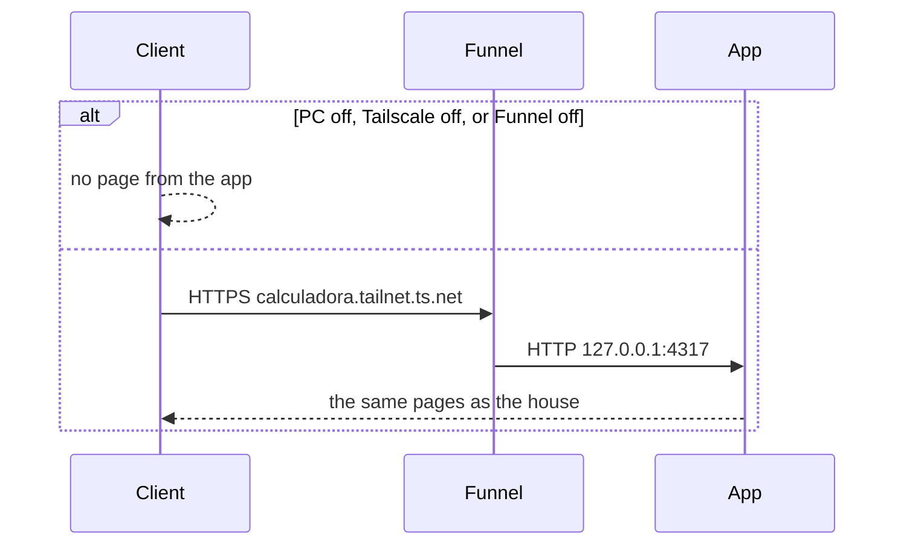

# URL pública

> Planeje a partir deste documento. Cada fatia abaixo carrega a própria forma — copie, não redesenhe.
> Status: confirmed by the owner, 2026-10-08

## Situation

- Project: em uso
- Decision: committed by the owner, 2026-10-08, in `.design/login.md` — a URL fora de casa vem depois do login; o dono reabriu isso nesta data, com as contas já separadas
- In flight: o login já pede a conta antes de qualquer página da calculadora, e uma conta não lê a impressora nem o projeto de outra. Estoque de filamentos, cliente do projeto e o resto do backlog ficam de fora.
- At stake: one-way

## Problem

O login foi feito para uma URL fora desta máquina poder existir. Sem essa URL, a calculadora só abre em `http://127.0.0.1:4317`, neste computador. Quem está longe usa o app só quando está na frente dele. O dono reabriu a URL em 2026-10-08, depois que a pessoa passa a entrar antes da calculadora e uma conta não vê os dados de outra — a condição que `.design/login.md` tinha deixado. Quantas pessoas vão abrir não foi medido; o dono disse que, por enquanto, são contas que já existem. Ele confirmou neste dia: conta nova só o admin, o endereço aponta para este PC, e o nome não é um domínio comprado.

## Success

- Worked if: com este PC ligado, uma conta que já existe abre a calculadora no nome HTTPS fixo, longe de casa, e vê só as impressoras e os projetos dela
- Going wrong: alguém sem conta cria uma conta nesse nome, ou o nome muda quando o PC reinicia
- Review: o dono, na primeira vez que abrir o nome num celular fora do Wi-Fi desta casa

## Boundary

In: um nome HTTPS fixo que chega neste PC enquanto ele está ligado. Nesse nome, e também em casa, só entra quem já tem conta. Conta nova continua no admin, em `/usuarios`. O cookie `sessao` nesse nome é `Secure`. Quem responde os dois endereços é o app construído.

Out: `calculadora.local` — esse nome só resolve na rede desta casa. Um domínio comprado — o dono não tem, e não compra para isto. A calculadora aberta com o PC desligado ou dormindo — o endereço aponta para esta máquina. Envio de e-mail para recuperar senha. Outros papéis além do admin e da conta comum. Publicar o Postgres no host — a credencial é a de desenvolvimento. Encaminhar a porta 4317 no roteador.

Unchanged: `http://127.0.0.1:4317`, `/`, `/projetos`, `/configuracoes`, `/usuarios`, `/entrar` para quem já entrou, peça, lote, mesas, a fórmula do custo, números digitados em texto, a porta 4317, o volume do Postgres, o banco sem porta no host, e o admin sem leitura das impressoras e dos projetos das outras contas.

## Prior art

- O TLS termina na borda e o app fica em 127.0.0.1, sem encaminhar porta — é o que o Funnel faz, e é o que este desenho usa. [Tailscale Funnel](https://tailscale.com/kb/1223/funnel)
- O nome público de um túnel rápido muda quando o processo sobe de novo — um nome assim perde, porque o endereço tem que ser o mesmo depois de reiniciar
- Certificado público grava o nome da máquina num livro aberto — a decisão 1 existe para o nome do nó ser `calculadora`, não um e-mail. [HTTPS certificates](https://tailscale.com/docs/how-to/set-up-https-certificates)

## Shape

O nome público é `https://calculadora.<tailnet>.ts.net` e, com este PC ligado, chega no mesmo app que a casa já abre. Quem não tem conta vê Entrar. A porta alcançada é a 4317 deste PC; o Postgres continua sem porta no host. Um domínio próprio, com a porta encaminhada e certificado nesta máquina, só ganha se o dono tiver o domínio e dispensar a conta Tailscale.

## Key decisions

1. **O nome público é `https://calculadora.<tailnet>.ts.net`, e o nó Tailscale deste PC se chama `calculadora`.** O sufixo `<tailnet>` é o que a Tailscale atribui à conta; este repositório não escolhe esse sufixo. Renomear o nó troca a URL. O nome entra no livro público de certificados.

2. **O Funnel só encaminha para o app em 127.0.0.1, na porta 4317.** O Postgres não ganha porta no host. O roteador não encaminha a 4317. Sem a conta Tailscale, sem o Funnel ligado, ou com o PC desligado ou dormindo, o app não recebe o pedido. O Funnel só escuta 443, 8443 ou 10000 na borda, e só fala com `http://127.0.0.1`.

3. **Quem responde `http://127.0.0.1:4317` e o nome público é o app construído.** Os dois endereços são o mesmo processo. O servidor de desenvolvimento não atende esse nome: o overlay de erro iria para a internet.

4. **No nome público o cookie `sessao` é `Secure`; em `http://127.0.0.1:4317` ele continua sem `Secure`.** Nos dois casos segue `HttpOnly`, `SameSite=Lax`, `Path=/` e 7 dias. Apagar a sessão repete o mesmo `Secure` da origem. Os dois pedidos chegam ao app como HTTP em 127.0.0.1, porque o TLS termina no Funnel. O app não decide `Secure` pelo esquema que vê nesse salto. A regra do login, que omite `Secure` em toda resposta, não vale para o nome público.

5. **Criar conta em `/entrar` e em `/criar` não grava conta.** Conta nova continua sendo a inclusão do admin em `/usuarios`, com a K2 Pro e zero projetos, como já é. Isso vale nos dois endereços, porque é o mesmo app.

## Work

| Slice | Delivers | Status |
|---|---|---|
| [Criar conta](#criar-conta) | `/entrar` não oferece conta nova, e `/criar` não grava conta | clear |
| [sessao](#sessao) | o cookie do nome público é `Secure`; o de casa, não | clear |
| [Funnel](#funnel) | `https://calculadora.<tailnet>.ts.net` chega no app deste PC ligado | clear |

Order: Criar conta → sessao → Funnel.

Already handled by existing code: e-mail ou senha que não confere em `/entrar`; admin inclui, redefine e apaga conta em `/usuarios`; cada conta lê só as próprias impressoras e os próprios projetos; admin não lê os dados das outras contas.

Derivable from the repository, left to the plan: texto de e-mail inválido, senha curta e e-mail duplicado na inclusão do admin; semente da K2 Pro; `Max-Age` de 7 dias — all as the login `sessao` does them.

### Criar conta

**Delivers** ninguém cria a própria conta, nem em casa nem no nome público. **Status: clear.**

| State | What should happen | Caller sees |
|---|---|---|
| GET `/entrar` sem `sessao` | a página não oferece conta nova | 200, título `Entrar`, sem o texto `Criar conta` |
| GET `/criar` | não há formulário | 307, Location `/entrar` |
| POST que criaria conta a partir de Entrar | nenhuma linha nova em `conta`, nenhum cookie `sessao` | 303, Location `/entrar` |

Alternatives considered: esconder `Criar conta` só no nome público — wins if a stranger on this LAN should still create their own conta. The owner said the admin creates every new conta.

### sessao

**Delivers** a sessão do nome público não sai em claro. **Status: clear.** Key decision 4.

| State | What should happen | Caller sees |
|---|---|---|
| Login no nome público | grava `sessao` com `Secure` | `Set-Cookie` contém `Secure` |
| Login em `http://127.0.0.1:4317` | grava `sessao` sem `Secure` | `Set-Cookie` sem `Secure` |
| Sair no nome público | apaga o cookie `Secure` dessa origem | o pedido seguinte sem `sessao` volta para `/entrar` |
| Sair em casa | apaga o cookie sem `Secure` | o pedido seguinte sem `sessao` volta para `/entrar` |

### Funnel

**Delivers** um nome HTTPS fixo para este PC ligado. **Status: clear.** Key decisions 1, 2 and 3.

| State | What should happen | Caller sees |
|---|---|---|
| PC ligado, Funnel ativo, nó `calculadora` | o nome chega no app em 127.0.0.1:4317 | a mesma página que a casa mostraria |
| PC desligado, Tailscale parado, ou Funnel desligado | o app não recebe o pedido | nenhuma página deste app |
| Pedido ao Postgres a partir de fora | não há porta no host | a conexão não abre |

Alternatives considered: túnel cujo hostname muda a cada subida — wins if the address may change when the PC reboots. It must stay fixed.

## Migration

Contas, impressoras e projetos já gravados ficam. Nenhuma coluna nova. `Criar conta` fecha antes de o Funnel ligar. Quem guardou `/criar` passa a cair em `/entrar`. A `sessao` já aberta em `http://127.0.0.1:4317` continua nessa origem. O nome público ainda não tem cookie.

## Sources

- `.design/login.md` — a URL fora de casa esperava o login; conta separada e admin sem ver os dados das outras
- `.specs/STATE.md` — AD-002, o Postgres sem porta no host; AD-005, o cookie sem `Secure` enquanto o app é HTTP na 4317; AD-006, o admin não lê outra conta
- [Tailscale Funnel](https://tailscale.com/kb/1223/funnel) — nome `*.ts.net` estável, TLS na borda, proxy só para `http://127.0.0.1`, portas 443, 8443 e 10000
- [Tailscale Funnel CLI](https://tailscale.com/docs/reference/tailscale-cli/funnel) — o proxy local é `http://127.0.0.1`
- [Set up HTTPS certificates](https://tailscale.com/docs/how-to/set-up-https-certificates) — o nome do nó e o da tailnet entram no livro público de certificados; mudar o nome da máquina muda o DNS
