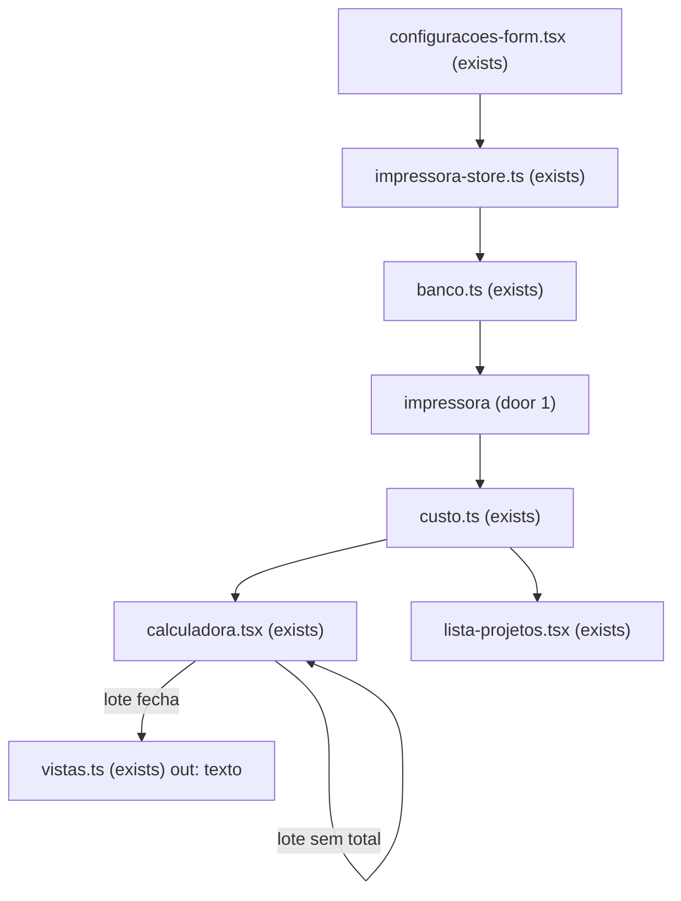

# Coeficiente

## Problem

Quem precifica nesta máquina passa o preço antes de imprimir. Nas últimas impressões, 1 peça em 5 se perdeu por erro da impressora, e esse custo não entrou no preço. Sem isto, o próximo orçamento cobra 4 por um trabalho de 5. O dono disse o 1 em 5 em 2026-10-26; a conta não registra essa perda. O texto que sai hoje lista o custo, e quem recebe o orçamento usa o total para aceitar.

Quando isto chega, o próximo orçamento com coeficiente 20 cobra o trabalho de 5 para entregar 4, e o cliente recebe o nome do lote, o cliente, o telefone e esse total.

## Flow

Reusa `calculate`, `draftToCalcInput`, `parseDecimal`, `formatBRL` e `formatDuration` em `custo.ts`, e a gravação de impressora que `impressora-store.ts` e `banco.ts` já fazem. O coeficiente não é uma segunda conta nem uma linha de resultado. A lista continua lendo o lote recalculado.

## Impact

| Front | What changes |
| --- | --- |
| domain | new term: `coeficiente` — o número na impressora; 20 é uma em cinco; vazio vale zero |
| domain | existing term: total da peça e total do lote eram a soma de material, energia, depreciação e mão de obra. Quem ramifica hoje: `calculate`, `calculadora.tsx`, `lista-projetos.tsx` e `textoOrcamento`. Com o coeficiente abaixo de 100, cada total em reais passa a ser essa soma do lado dividida por (1 − coeficiente/100). Minutos, gramas e as quatro linhas continuam o custo real |
| domain | existing term: orçamento era o texto com material, energia, depreciação, mão de obra, peso, a impressora e os avisos. Quem ramifica: `textoOrcamento`. Passa a ser o nome do lote, o cliente, o telefone e o preço |
| stored data | impressora já gravada passa a ler coeficiente vazio. `projeto`, `cor` e `mesa` não são reescritos. O total continua fora do projeto |

## Relations

O coeficiente não é entidade. Cada `impressora` tem o próprio coeficiente, texto vazio permitido (door 1). Nenhum projeto guarda cópia desse número. Sem diagrama: não há segunda tabela. Sem colunas e sem tipos aqui.

## Surface

None - nothing consumed outside. `/`, `/projetos` e `/configuracoes` continuam as mesmas rotas, e `?projeto=` continua o mesmo.

## Landing

| One-way door | Literal shape | Alternative rejected |
| --- | --- | --- |
| Coeficiente na impressora | `ALTER TABLE impressora ADD COLUMN coefficient text NOT NULL DEFAULT ''`. Texto, como manda AD-003. Vazio é `''` | uma coluna em `projeto` — o lote guardaria o preço depois que o coeficiente da máquina mudasse, e a lista deixaria de acompanhar a impressora |
| Total só em reais | o total da peça e o total do lote são, cada um, a soma em reais desse lado dividida por (1 − coeficiente/100). Material, energia, depreciação, mão de obra, minutos e gramas ficam sem esse fator | multiplicar as quatro linhas pelo mesmo fator — o material deixaria de ser gramas × preço |

- Nada mais nesta mudança é difícil de reverter

## Criteria

A impressora dos números abaixo, quando o critério não disser outra, é 100 W, R$ 1/kWh, R$ 1000 e 1000 h, com nome `Prova`. O lote de prova, quando o critério não disser outro, é modo `peca`, 0 h, 0 min, mão de obra `10`, uma cor de 800 g a R$ 100/kg. Isso fecha material 80, energia 0, depreciação 0, mão de obra 8 e soma 88.

### S1: Coeficiente no total (P1)

O número fica na impressora. O total em reais da peça e do lote usa esse número. As linhas continuam o custo real.

**Acceptance Criteria**

1. WHEN the owner saves coefficient `20` on `Prova` THEN the system SHALL return `20` on the next read
2. WHEN the owner saves coefficient `""` THEN the system SHALL return `""` on the next read
3. WHEN the owner saves coefficient ` 20 ` THEN the system SHALL return ` 20 ` on the next read
4. WHEN the owner saves coefficient `100` THEN the system SHALL return `100` on the next read
5. WHEN the owner saves coefficient `abc` THEN the system SHALL return `abc` on the next read
6. WHEN a printer payload omits coefficient THEN the system SHALL read `""`
7. WHEN the coefficient column is added to an impressora row that had none THEN the system SHALL read `""`
8. The system SHALL serialize the printer payload with version `3`
9. WHEN the owner adds a printer THEN the system SHALL name it `Nova impressora` and its coefficient SHALL be `""`
10. WHEN the seeded printer is `k2-pro` THEN the system SHALL read coefficient `""`
11. WHEN conta A saves coefficient `20` on `k2-pro` THEN conta B's `k2-pro` SHALL read coefficient `""`
12. IF a save that sets coefficient `20` fails THEN the next read SHALL return the previous coefficient `""`
13. WHILE the printer form is open the system SHALL show a field labeled `Coeficiente de erro (%)`
14. WHEN coefficient is `""` and the lote de prova is calculated THEN piece total and lot total SHALL each equal the `formatBRL` string of 88, material SHALL equal the `formatBRL` string of 80, labor SHALL equal the `formatBRL` string of 8, and time SHALL be `0 min`
15. WHEN coefficient is `20` and the lote de prova is calculated THEN piece total and lot total SHALL each equal the `formatBRL` string of 110, material SHALL equal the `formatBRL` string of 80, labor SHALL equal the `formatBRL` string of 8, grams SHALL equal the `formatGrams` string of 800, and time SHALL be `0 min`
16. WHEN coefficient is `0` and the lote de prova is calculated THEN piece total and lot total SHALL each equal the `formatBRL` string of 88
17. WHEN coefficient is `99` and the lote de prova is calculated THEN piece total and lot total SHALL each equal the `formatBRL` string of 8800
18. WHEN coefficient is `99,9` and the lote de prova is calculated THEN piece total and lot total SHALL each equal the `formatBRL` string of 88000
19. IF coefficient is `100` and the lote de prova is calculated THEN piece total and lot total SHALL each be `—` and material SHALL equal the `formatBRL` string of 80
20. IF coefficient is `101` and the lote de prova is calculated THEN piece total and lot total SHALL each be `—`
21. IF coefficient is `abc` and the lote de prova is calculated THEN piece total and lot total SHALL each be `—`
22. WHEN coefficient is `   ` and the lote de prova is calculated THEN piece total and lot total SHALL each equal the `formatBRL` string of 88
23. The cost table SHALL NOT contain a row labeled `Coeficiente de erro (%)` and SHALL NOT contain `Peças perdidas`
24. WHEN the list renders the lote de prova with coefficient `20` and the project is not saved again THEN the system SHALL show the `formatBRL` string of 110
25. WHEN coefficient changes from `20` to `""` and the project is not saved again THEN the list SHALL show the `formatBRL` string of 88
26. WHEN mode is `lote`, copies are `4`, coefficient is `20`, time is 0 minutes, labor is `10` and one color is 800 g at R$ 100/kg THEN piece total SHALL equal the `formatBRL` string of 27.5, lot total SHALL equal the `formatBRL` string of 110, piece material SHALL equal the `formatBRL` string of 20, lot material SHALL equal the `formatBRL` string of 80, piece labor SHALL equal the `formatBRL` string of 2 and lot labor SHALL equal the `formatBRL` string of 8
27. WHEN two mesas each have 0 hours, 0 minutes, 400 g and price `100`, labor is `10`, copies are `2` and coefficient is `20` THEN piece material SHALL equal the `formatBRL` string of 80, lot material SHALL equal the `formatBRL` string of 160, piece labor SHALL equal the `formatBRL` string of 8, lot labor SHALL equal the `formatBRL` string of 16, piece total SHALL equal the `formatBRL` string of 110 and lot total SHALL equal the `formatBRL` string of 220
28. WHEN the mesas in AC 27 have copies `0` and coefficient `20` THEN piece total SHALL equal the `formatBRL` string of 110, lot total SHALL be `—` and the system SHALL NOT show `Copiar orçamento`
29. IF labor is `""` and coefficient is `20` THEN piece total and lot total SHALL each be `—`

**Independent test:** gravar `20` em Prova, abrir o lote de prova e ver o total `formatBRL(110)` com material `formatBRL(80)`; esvaziar o coeficiente e o total volta a `formatBRL(88)`.

### S2: Texto do cliente (P2)

O texto copiado leva o nome, o cliente, o telefone e o preço. O detalhe do custo fica na calculadora.

**Acceptance Criteria**

30. WHEN coefficient is `20`, the lote de prova closes, the lote name is `Suporte`, client name is `Ana` and client phone is `11999990000` THEN the system SHALL show a control labeled `Copiar orçamento` and the text SHALL contain `Suporte`, `Cliente: Ana`, `Telefone: 11999990000`, `Total:`, the `formatBRL` string of 110 and `0 min`
31. WHEN the text in AC 30 is produced THEN the text SHALL NOT contain `Material`, `Energia`, `Depreciação`, `Mão de obra`, `Peso`, `Prova:`, `Coeficiente` or `Peças perdidas`
32. WHEN the project in AC 30 has client name and client phone that trim to empty THEN the text SHALL NOT contain `Cliente:` and SHALL NOT contain `Telefone:` and SHALL contain the `formatBRL` string of 110
33. WHEN mode is `lote`, copies are `4`, coefficient is `20`, time is 0 minutes, labor is `10` and one color is 800 g at R$ 100/kg THEN the text SHALL contain `Por peça`, `Lote`, the `formatBRL` string of 27.5 and the `formatBRL` string of 110, and SHALL NOT contain `Total:`
34. IF coefficient is `100` and the lote de prova is calculated THEN the system SHALL NOT show `Copiar orçamento`
35. WHEN mode is `lote`, copies are `0`, coefficient is `20`, time is 0 minutes, labor is `10` and one color is 800 g at R$ 100/kg THEN the text SHALL contain the `formatBRL` string of 110 and SHALL NOT contain `Por peça` and SHALL NOT contain `Custo por peça bloqueado. No modo lote, cópias precisa ser maior que zero.`
36. WHEN the input in AC 35 is on the calculator THEN the screen SHALL show `Custo por peça bloqueado. No modo lote, cópias precisa ser maior que zero.`
37. WHEN the mesas in AC 28 are on the calculator THEN the screen SHALL show `Custo do lote bloqueado. Cópias do produto precisa ser um inteiro maior que zero.` and the text SHALL NOT contain that sentence
38. WHEN the project's printer was removed, the marked printer is `Prova` and coefficient is `20` THEN the text SHALL contain the `formatBRL` string of 110 and SHALL NOT contain `A impressora gravada neste projeto foi removida. O cálculo usa a máquina marcada agora.` and SHALL NOT contain `Prova:`
39. WHEN the input in AC 38 is on the calculator THEN the screen SHALL show `A impressora gravada neste projeto foi removida. O cálculo usa a máquina marcada agora.`
40. IF the clipboard write fails THEN the calculator SHALL show the text from AC 30 for selection
41. WHEN the owner copies the orçamento twice THEN the system SHALL still have one project with that id
42. WHEN the text from AC 30 has been produced and the coefficient then changes from `20` to `""` without saving the project THEN the system SHALL leave that text unchanged and the list SHALL show the `formatBRL` string of 88
43. WHEN the project has no colors, mode `peca`, 0 minutes, labor `0` and coefficient `20`, and the lot total closes THEN the text SHALL NOT contain `Nenhuma cor de filamento. O material entra como R$ 0,00.`
44. WHEN the input in AC 43 is on the calculator THEN the screen SHALL show `Nenhuma cor de filamento. O material entra como R$ 0,00.`
45. WHEN the colors in AC 30 are named `PLA preto` THEN the text SHALL NOT contain `PLA preto`
46. The projetos list SHALL NOT show a control labeled `Copiar orçamento`

**Independent test:** no lote de prova com coeficiente `20`, copiar e ver `Cliente: Ana` e o `formatBRL` de 110, sem a palavra `Material`.

## Out of scope

| Excluded | Why |
| --- | --- |
| Purga | o dono deixou para a conversa seguinte |
| Linha com o nome da perda no resultado, na lista ou no texto | o dono não quer mostrar o coeficiente |
| Coeficiente no projeto | só se um lote for mais arriscado que a impressora |
| Histórico de falhas e coeficiente calculado sozinho | ficam de fora até alguém pedir |
| Refugo | filamento que sobra fora da peça |
| PDF, e-mail e logo | já fora do orçamento |
| Gravar `20` na K2 Pro de fábrica | reprecificaria lote já salvo |
| Gravar o total no projeto | a lista recalcula com a impressora atual, AD-009 |

## Assumptions

Nenhum default fora dos critérios.

**Open questions:** none - all resolved or logged above.

## Observable

| Surface | Decision | Landing |
| --- | --- | --- |
| screen Calculadora | empty state | AC 14, AC 22 |
| screen Calculadora | loading | existing - `Lendo impressoras e projetos.` |
| screen Calculadora | error | AC 12 |
| screen Calculadora | unauthorised | existing - AD-005, sem sessão a conta não lê a impressora |
| screen Calculadora | density and ordering | AC 15, AC 23, AC 30 |
| screen Calculadora | destructive action | n/a - esta feature não apaga projeto |
| screen Projetos | empty state | existing - `Nenhum projeto salvo` |
| screen Projetos | loading | existing - `Lendo impressoras e projetos.` |
| screen Projetos | error | existing - `Não deu para ler o banco.` |
| screen Projetos | unauthorised | existing - AD-005 |
| screen Projetos | density and ordering | AC 24, AC 46 |
| screen Projetos | destructive delete | existing - segundo clique em `confirmar-apagar`; o coeficiente fica na impressora |
| screen Configurações | empty state | AC 9, AC 10, AC 13 |
| screen Configurações | loading | existing - `Lendo impressoras e projetos.` |
| screen Configurações | error | AC 12 |
| screen Configurações | unauthorised | existing - AD-005 |
| screen Configurações | density and ordering | AC 13 |
| screen Configurações | destructive remove printer | existing - a última impressora não sai; remover a outra apaga o coeficiente com a linha |
| API | error shape, caller, versioning, rate limit | n/a - nenhuma rota nova; a falha de banco continua `Não deu para ler o banco.` |
| document orçamento | structure and depth | AC 30, AC 31, AC 33, AC 35 |
| document orçamento | tone | existing - os rótulos de preço são os da tela |
| document orçamento | next step | n/a - o texto é o preço; enviar fica fora |
| collection impressoras | grouping, naming, duplicates | AC 8, AC 9, AC 11 |

## Sources

- `.design/coeficiente.md`, confirmado pelo dono em 2026-10-26 — as seis decisões e as duas fatias
- `docs/custo.md` — a soma que o coeficiente encontra já fechada
- `.specs/STATE.md` AD-003 e AD-009 — texto digitado, e o orçamento continua uma leitura sem total no projeto
