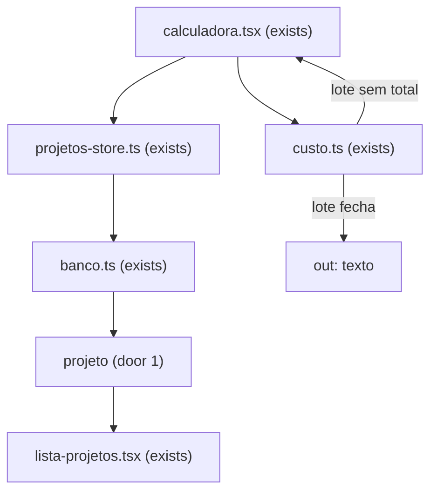

# Orçamento

## Problem

Quem precifica nesta máquina passa o preço para quem pediu a peça. O projeto não diz quem pediu, e o total do lote só aparece na tela. A pessoa copia os números à mão e escreve o nome em outro lugar. Cada orçamento continua esses dois passos. Quantas vezes por semana não foi medido; o dono confirmou em 2026-10-26 que o cliente e o orçamento são o mesmo ato.

Quando isto chega, o próximo orçamento é um texto copiado que já traz o nome da pessoa e o total do lote, sem redigitar os números.

## Flow

Reusa `calculate`, `formatBRL`, `formatDuration` e `formatGrams` em `custo.ts`, e a gravação que `projetos-store.ts` e `banco.ts` já fazem do projeto. O texto não é uma segunda conta. A lista continua lendo o lote recalculado.

## Impact

| Front | What changes |
| --- | --- |
| domain | new term: `cliente` — nome e telefone de quem pediu a peça, gravados no próprio projeto |
| domain | new term: `orçamento` — o texto da calculadora na hora da cópia. Não é um registro |
| domain | existing term: projeto era o lote, a impressora, o modo, as cópias, o tempo, a mão de obra e as cores ou as mesas — `parseProject`, `copyProject`, `lista-projetos.tsx` e `calculadora.tsx` ramificam nisso. Agora o mesmo projeto também carrega o cliente. O total continua de fora |
| stored data | projeto já gravado passa a ler nome e telefone vazios. Cores, mesas, tempo e impressora não são reescritos. O total continua fora do projeto |

## Relations

O cliente não é entidade. Cada `projeto` tem o próprio nome de cliente e o próprio telefone, os dois podendo ser texto vazio (door 1). Nenhum outro projeto aponta para esse par. Sem diagrama: não há segunda tabela. Sem colunas e sem tipos aqui.

## Surface

None - nothing consumed outside. `/`, `/projetos` e `/configuracoes` continuam as mesmas rotas, e `?projeto=` continua o mesmo.

## Landing

| One-way door | Literal shape | Alternative rejected |
| --- | --- | --- |
| Cliente no projeto | `ALTER TABLE projeto ADD COLUMN client_name text NOT NULL DEFAULT ''` e `ADD COLUMN client_phone text NOT NULL DEFAULT ''`. Os dois ficam texto, como manda AD-003. Vazio é `''`. Não há tabela `cliente` | uma tabela `cliente` que vários projetos apontam — a mesma pessoa não está em vários lotes, e o telefone não precisa mudar num lugar só |

- Nada mais nesta mudança é difícil de reverter

## Criteria

A impressora dos números abaixo, quando o critério não disser outra, é 100 W, R$ 1/kWh, R$ 1000 e 1000 h, com nome `Prova`.

### S1: Cliente no projeto (P1)

O lote guarda quem pediu. A lista mostra esse cliente. Duplicar copia os dois campos.

**Acceptance Criteria**

1. WHEN the owner saves client name `Ana` and client phone `11999990000` THEN the system SHALL return both strings on the next read
2. WHEN the owner saves client name `""` and client phone `""` THEN the system SHALL return both as `""` and SHALL keep the project in the list
3. WHEN the owner saves client name ` Ana ` THEN the system SHALL return ` Ana ` on the next read
4. WHEN the owner saves client phone `11 99999-0000` THEN the system SHALL return `11 99999-0000` on the next read
5. WHEN the list renders a project with client name `Ana` and client phone `11999990000` THEN the system SHALL show `Ana` and `11999990000` with the lote
6. WHEN the list renders a project with client name `   ` and client phone `  ` THEN the system SHALL show the same lote line it shows when both fields are `""`
7. WHEN the owner duplicates a project with client name `Ana` and client phone `11999990000` THEN the system SHALL name the copy with the suffix ` (cópia)` and the copy SHALL have client name `Ana` and client phone `11999990000`
8. WHEN the client columns are added to a projeto row that had no client THEN the system SHALL read client name `""` and client phone `""`
9. WHEN a projects payload omits the client name and the client phone THEN the system SHALL read both as `""`
10. The system SHALL serialize the projects payload with version `1`
11. WHEN the owner deletes a project with client name `Ana` THEN the next read SHALL NOT return that project id
12. WHILE client name and phone are `""` the calculator SHALL show a field labeled `Cliente` and a field labeled `Telefone`
13. IF a save carries a loaded `updated_at` that is not the row's current `updated_at` and the save sets client name `Bia` THEN the system SHALL commit nothing and the next read SHALL return client name `Ana`
14. IF a save that sets client name `Bia` fails THEN the next read SHALL return client name `Ana`

**Independent test:** gravar `Ana` e `11999990000`, ver os dois na lista, duplicar e ler o mesmo cliente na cópia; um lote sem cliente continua na lista sem linha de cliente.

### S2: Texto do orçamento (P1)

A calculadora copia o resultado quando o total do lote fecha. O texto não é gravado.

**Acceptance Criteria**

15. WHEN mode is `lote`, copies are `2`, time is 60 minutes, labor is `20`, one color is 10 g at R$ 100/kg and another is 20 g at R$ 50/kg, and the lot total closes THEN the system SHALL show a control labeled `Copiar orçamento`
16. WHEN the owner uses `Copiar orçamento` on the project in AC 15, with lote name `Suporte`, client name `Ana` and client phone `11999990000` THEN the system SHALL produce text that contains `Suporte`, `Cliente: Ana`, `Telefone: 11999990000`, `Prova: 100 W, 1 R$/kWh, impressora 1000, 1000 h.`, `Por peça`, `Lote`, `Material`, `Energia`, `Depreciação`, `Mão de obra` and `Peso`, in that label order, plus the `formatBRL`, `formatDuration` and `formatGrams` strings of the piece and of the lot from `calculate` for that input
17. WHEN the project in AC 15 has client name and client phone that trim to empty THEN the text SHALL NOT contain `Cliente:` and SHALL NOT contain `Telefone:` and SHALL contain the `formatBRL` string of the lot total
18. WHEN mode is `lote`, copies are `0`, time is 60 minutes, labor is `20` and one color is 10 g at R$ 100/kg THEN the text SHALL contain `Custo por peça bloqueado. No modo lote, cópias precisa ser maior que zero.` and the `formatBRL` string of the lot total, and SHALL NOT contain `Por peça`
19. WHEN a project of two mesas, each with hours `0`, minutes `0`, grams `1000` and price `100`, labor `10` and copies `0`, has a piece total and a null lot total THEN the system SHALL NOT show `Copiar orçamento`
20. WHEN the project's printer was removed and the marked printer is `Prova` THEN the text SHALL contain `A impressora gravada neste projeto foi removida. O cálculo usa a máquina marcada agora.` and `Prova: 100 W, 1 R$/kWh, impressora 1000, 1000 h.`
21. WHEN the calculator shows client name `Bia` and the last save stored client name `Ana` THEN the text SHALL contain `Bia` and the next read SHALL return `Ana`
22. IF the clipboard write fails THEN the calculator SHALL show that same text for selection
23. WHEN the owner copies the orçamento twice THEN the system SHALL still have one project with that id
24. WHEN the text for AC 15 has been produced and the printer energy price then changes from `1` to `2` without saving the project THEN the system SHALL leave that text unchanged and SHALL reprice the listed lot from the new tariff
25. WHEN the project has no colors, mode `peca`, 60 minutes and labor `0`, and the lot total closes THEN the text SHALL contain `Nenhuma cor de filamento. O material entra como R$ 0,00.`
26. WHEN the colors in AC 15 are named `PLA preto` and `PLA branco` THEN the text SHALL NOT contain `PLA preto` and SHALL NOT contain `PLA branco`
27. The projetos list SHALL NOT show a control labeled `Copiar orçamento`

**Independent test:** no lote de AC 15, copiar e ver `Cliente: Ana` e o total do lote no texto; com cópias `0` em duas mesas fechadas, o botão não aparece.

## Out of scope

| Excluded | Why |
| --- | --- |
| PDF | só se precisar de arquivo para anexar |
| Cadastro de clientes solto do projeto | a mesma pessoa não está em vários lotes, e o telefone não precisa mudar num lugar só |
| Envio por e-mail ou mensagem, e modelo com logo | fora do item até alguém pedir |
| Endereço, e-mail, documento e mais de um telefone | fora do item até alguém pedir |
| Gravar o total no projeto | a lista recalcula com a tarifa atual da impressora |
| Valor de cada cor no texto | só se quem recebe o orçamento pedir o preço por filamento |
| Estoque de filamentos, refugo, impressão falha, purge, mão de obra por hora, tarifa por projeto | backlog |
| Login e mesas | já desenhados; esta feature não muda a sessão nem a chapa |

## Assumptions

Nenhum default fora dos critérios.

**Open questions:** none - all resolved or logged above.

## Observable

| Surface | Decision | Landing |
| --- | --- | --- |
| screen Calculadora | empty state | AC 12 |
| screen Calculadora | loading | existing - `Lendo impressoras e projetos.` |
| screen Calculadora | error | AC 14, AC 22 |
| screen Calculadora | unauthorised | existing - AD-005, sem sessão a conta não lê o projeto |
| screen Calculadora | density and ordering | AC 12, AC 15, AC 16 |
| screen Calculadora | destructive action | n/a - esta feature não apaga; apagar continua o segundo clique da lista |
| screen Projetos | empty state | existing - `Nenhum projeto salvo` |
| screen Projetos | loading | existing - `Lendo impressoras e projetos.` |
| screen Projetos | error | existing - `Não deu para ler o banco.` |
| screen Projetos | unauthorised | existing - AD-005, sem sessão a conta não lê o projeto |
| screen Projetos | density and ordering | AC 5, AC 6 |
| screen Projetos | destructive delete | existing - segundo clique em `confirmar-apagar` antes de apagar; AC 11 leva o cliente junto |
| screen Configurações | empty, loading, error, density, destructive | n/a - esta feature não muda Configurações |
| API | error shape, caller, versioning, rate limit | n/a - nenhuma rota nova; a falha de banco continua `Não deu para ler o banco.` |
| document orçamento | structure and depth | AC 16, AC 17, AC 18, AC 25, AC 26 |
| document orçamento | tone | existing - os rótulos são os da tabela de resultado |
| document orçamento | next step | n/a - o texto é o preço; enviar fica fora |
| collection projetos | grouping, naming, duplicates | AC 7, AC 10, AC 23 |

## Sources

- `.design/orcamento.md`, confirmado pelo dono em 2026-10-26 — as cinco decisões e as duas fatias
- `.design/mesas.md` — o projeto não guarda o total; a lista recalcula com a tarifa da impressora
- `.specs/STATE.md` AD-003, AD-004 e AD-005 — texto digitado, impressão ou mesas, sessão por conta
