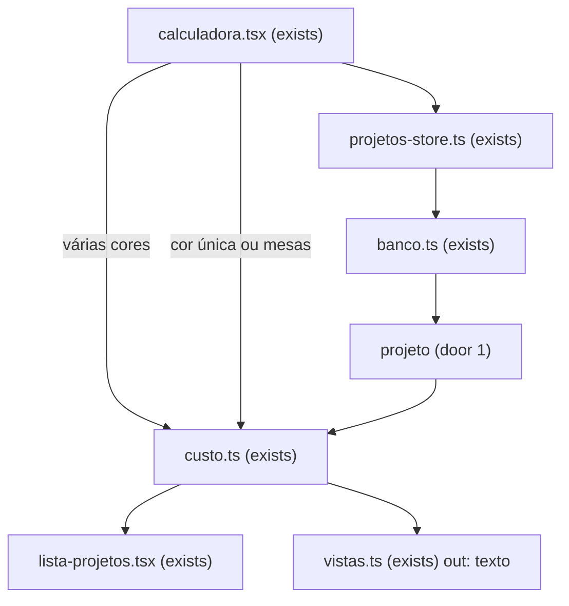

# Purge

## Problem

Quem precifica nesta máquina passa o preço antes de imprimir. Numa impressão de várias cores o material cobrado é só as gramas de cada cor, e o filamento gasto na troca no meio da peça fica de fora. Sem isto, o próximo orçamento de várias cores cobra a peça e esquece essa troca. Quantas trocas por peça não foi medido. O dono disse em 2026-10-28 que esse peso é um número da impressão, não da máquina, e em 2026-10-29 que nem toda impressão tem esse número: quando não tem, o preço segue só com as cores. Num projeto de mesas cada mesa é um filamento só e não troca no meio.

Quando isto chega, o próximo orçamento de várias cores com um número em “Purge por troca (g)” cobra cada troca pelo preço da cor que entra. Sem número, o orçamento fecha nas cores. Um projeto de mesas continua o total de hoje.

## Flow

Reusa `calculate`, `draftToCalcInput` e `parseDecimal` em `custo.ts`, e a gravação e a cópia que `projetos-store.ts` e `banco.ts` já fazem. O purge não é uma segunda conta nem uma linha de resultado. A lista continua lendo o lote recalculado com a tarifa e o coeficiente da impressora atual. Cor única e mesas atravessam o mesmo `calculate` sem ler o texto.

## Impact

| Front | What changes |
| --- | --- |
| domain | new term: `purge` — as gramas por troca da impressão de várias cores; vazio vale zero; mora no projeto |
| domain | existing term: material de uma cor era gramas × (R$/kg ÷ 1000). Quem ramifica hoje: `calculate` e a lista de cores em `calculadora.tsx`. Na cor que entra, a linha passa a somar também o purge em reais. A soma das linhas continua o material do valor digitado |
| domain | existing term: peso era a soma das gramas digitadas nas cores. Quem ramifica: `calculate` e a linha Peso. Continua essa soma. O purge não entra |
| domain | existing term: gramas vazias de uma cor anulam o material (`invalid-color`). Quem ramifica: `calculate` e a gravação em `calculadora.tsx`. O purge vazio não anula; o purge inválido anula material, mão de obra e totais |
| stored data | projeto já gravado passa a ler purge vazio. `cor`, `mesa` e `impressora` não são reescritos. O total continua fora do projeto |

## Relations

O purge não é entidade. Cada `projeto` tem o próprio purge, vazio permitido (door 1). `cor`, `mesa` e `impressora` não têm. Sem diagrama: não há segunda tabela. Sem colunas e sem tipos aqui.

## Surface

None - nothing consumed outside. `/`, `/projetos` e `/configuracoes` continuam as mesmas rotas, e `?projeto=` continua o mesmo.

## Landing

| One-way door | Literal shape | Alternative rejected |
| --- | --- | --- |
| Purge no projeto | `ALTER TABLE projeto ADD COLUMN purge text NOT NULL DEFAULT ''`. Vazio é `''` e a conta lê zero. Texto, como manda AD-003 | uma coluna em `impressora` — a decisão 1 recusou; um padrão da máquina com outro número no lote fica de fora. Uma coluna em `cor` — cada troca passaria a ter o próprio peso, e o dono pediu um número só |
| Reais na cor que entra | com N cores na ordem de `cor.posicao`, as trocas são max(0, N−1). A primeira cor não soma purge. Cada cor seguinte soma `purge_g × (R$/kg ÷ 1000)` na própria linha de material. A linha de peso continua a soma das gramas digitadas | somar as gramas de purge no peso — o peso deixaria de ser as gramas da peça |

- Nada mais nesta mudança é difícil de reverter

## Criteria

A impressora dos números abaixo, quando o critério não disser outra, é 100 W, R$ 1/kWh, R$ 1000 e 1000 h, coeficiente `''`, nome `Prova`. A impressão de prova, quando o critério não disser outra, é modo `peca`, 0 h, 0 min, mão de obra `0`, `color_mode` várias cores, sem mesas, e três cores nesta ordem: preto 20 g a R$ 80/kg, branco 10 g a R$ 120/kg, vermelho 5 g a R$ 100/kg. Sem purge isso fecha material 3.3 e peso 35. Os números de material abaixo são os do valor digitado, antes de peça e lote escalarem, salvo quando o critério nomear peça ou lote.

### S1: Purge na conta (P1)

O material da impressão de várias cores inclui o purge em reais na cor que entra. O peso continua as gramas digitadas. Mesas e cor única não leem o texto.

**Acceptance Criteria**

1. WHEN the impressão de prova has purge `30` THEN preto material SHALL equal 1.6, branco material SHALL equal 4.8, vermelho material SHALL equal 3.5, material SHALL equal 9.9 and grams SHALL equal 35
2. WHEN the impressão de prova has purge `''` THEN material SHALL equal 3.3 and grams SHALL equal 35
3. WHEN the impressão de prova has purge `0` THEN material SHALL equal 3.3 and grams SHALL equal 35
4. WHEN the impressão de prova has purge `   ` THEN material SHALL equal 3.3 and grams SHALL equal 35
5. WHEN color mode is várias cores, the only color is preto 20 g at R$ 80/kg and purge is `30` THEN material SHALL equal 1.6 and grams SHALL equal 20
6. WHEN the colors are vermelho 5 g at R$ 100/kg, then branco 10 g at R$ 120/kg, then preto 20 g at R$ 80/kg, and purge is `30` THEN vermelho material SHALL equal 0.5, branco material SHALL equal 4.8, preto material SHALL equal 4 and material SHALL equal 9.3
7. WHEN two colors are both named `PLA preto`, the first is 20 g at R$ 80/kg, the second is 10 g at R$ 120/kg and purge is `30` THEN the first material SHALL equal 1.6, the second material SHALL equal 4.8, material SHALL equal 6.4 and grams SHALL equal 30
8. WHEN the impressão de prova has purge `30,5` THEN branco material SHALL equal 4.86, vermelho material SHALL equal 3.55 and material SHALL equal 10.01
9. IF purge is `abc` on the impressão de prova THEN material SHALL be null, labor SHALL be null, piece total SHALL be null and lot total SHALL be null
10. IF purge is `-1` on the impressão de prova THEN material SHALL be null
11. IF preto grams are `''` and purge is `30` THEN material SHALL be null
12. WHEN there are no colors and purge is `''` THEN material SHALL equal 0
13. WHEN there are no colors and purge is `30` THEN material SHALL equal 0
14. IF there are no colors and purge is `abc` THEN material SHALL be null
15. WHEN color mode is `unica`, grams are `800`, the color price is `100` and purge is `30` THEN material SHALL equal 80 and grams SHALL equal 800
16. WHEN the project has one mesa of 0 hours, 0 minutes, 1000 g and price `100`, labor is `0`, copies are `1` and purge is `30` THEN piece material SHALL equal 100, piece grams SHALL equal 1000 and piece total SHALL equal 100
17. WHEN the impressão de prova has purge `30` and labor `10` THEN piece material SHALL equal 9.9, piece labor SHALL equal 0.99, piece grams SHALL equal 35 and piece total SHALL equal 10.89
18. WHEN the input in AC 17 has minutes `60` THEN piece energy SHALL equal 0.1, piece depreciation SHALL equal 1, piece labor SHALL equal 1.1 and piece material SHALL equal 9.9
19. WHEN the impressão de prova has purge `30`, labor `0` and coefficient `20` THEN piece material SHALL equal 9.9, piece labor SHALL equal 0, piece grams SHALL equal 35 and piece total SHALL equal 12.375
20. WHEN mode is `lote`, copies are `2`, labor is `0` and the impressão de prova has purge `30` THEN lot material SHALL equal 9.9, piece material SHALL equal 4.95, lot grams SHALL equal 35, piece grams SHALL equal 17.5, preto material SHALL equal 1.6, branco material SHALL equal 4.8 and vermelho material SHALL equal 3.5
21. WHEN mode is `lote`, copies are `0`, labor is `0` and the impressão de prova has purge `30` THEN piece total SHALL be null, lot material SHALL equal 9.9 and lot grams SHALL equal 35
22. IF purge is `abc`, minutes are `60` and the three colors of the impressão de prova close THEN piece energy SHALL equal 0.1, piece depreciation SHALL equal 1, piece material SHALL be null and piece labor SHALL be null

**Independent test:** na impressão de prova com purge `30`, o material fecha em 9.9, o branco em 4.8 e o peso em 35; com purge `''`, o material volta a 3.3.

### S2: Campo, gravação e cópia (P2)

O campo aparece só na impressão de várias cores. Vazio grava. Inválido não grava. Duplicar leva o texto, mesmo sem uso.

**Acceptance Criteria**

23. WHILE color mode is várias cores and the project has no mesas the system SHALL show a field labeled `Purge por troca (g)`
24. WHILE color mode is `unica` the system SHALL NOT show a field labeled `Purge por troca (g)`
25. WHILE the project has at least one mesa the system SHALL NOT show a field labeled `Purge por troca (g)`
26. WHILE the field is shown and purge is `''` the system SHALL NOT show `Campo vazio.`
27. WHEN the owner saves purge `30` on a project named `Suporte` THEN the next read SHALL return `30`
28. WHEN the owner saves purge `''` on a project named `Suporte` whose other fields close THEN the next read SHALL return `''`
29. WHEN the owner saves purge ` 30 ` THEN the next read SHALL return ` 30 `
30. WHEN the owner saves purge `   ` THEN the next read SHALL return `   `
31. WHEN a projeto row had no purge value THEN the next read SHALL return `''`
32. WHEN a project payload omits purge THEN the system SHALL read `''`
33. WHEN the owner tries to save a new project named `Suporte` with purge `abc` THEN the system SHALL NOT create that project and SHALL mark the field with `Use zero ou um número positivo.`
34. WHEN the stored purge is `''` and the owner tries to save purge `abc` THEN the next read SHALL return `''`
35. WHEN the owner saves purge `30` and then saves that project as color mode `unica` THEN the next read SHALL return purge `30`
36. WHEN the owner saves purge `30` and then saves that project with one mesa THEN the next read SHALL return purge `30`
37. WHEN the owner duplicates a project named `Suporte` whose purge is `30` THEN the copy SHALL have purge `30` and the name `Suporte (cópia)`
38. WHEN the owner duplicates a mesas project whose unused purge is `30` THEN the copy SHALL have purge `30`
39. WHEN the owner saves purge `30` twice on the same project id THEN the system SHALL still have one project with that id and purge `30`
40. WHEN conta A saves purge `30` on a project THEN a read as conta B SHALL NOT return that purge `30`
41. IF a save that sets purge `30` loses the race THEN the next read SHALL return the previous purge `''`
42. The cost table SHALL NOT contain a row labeled `Purge`
43. WHEN the impressão de prova with purge `30` and labor `0` is on the calculator THEN the weight row SHALL be the `formatGrams` string of 35
44. WHEN the impressão de prova has purge `30`, labor `0`, the lote name is `Suporte`, client name is `Ana` and client phone is `11999990000` THEN the text SHALL contain the `formatBRL` string of 9.9 and SHALL NOT contain `Purge` and SHALL NOT contain `Material`
45. IF purge is `abc` THEN the system SHALL NOT show `Copiar orçamento`
46. WHEN the list renders the saved impressão de prova with purge `30`, labor `0` and the project is not saved again THEN the system SHALL show the `formatBRL` string of 9.9
47. WHEN coefficient changes from `''` to `20` and the project in AC 46 is not saved again THEN the list SHALL show the `formatBRL` string of 12.375 and the stored purge SHALL stay `30`
48. The printer form SHALL NOT show a field labeled `Purge por troca (g)`
49. IF purge is `abc` and every color of the impressão de prova closes THEN the screen SHALL NOT show `Há cor com preço ou peso vazio ou inválido.`
50. IF a color price is `''` and purge is `30` THEN the screen SHALL show `Há cor com preço ou peso vazio ou inválido.`
51. WHEN there are no colors and purge is `''` THEN the screen SHALL show `Sem cores. Material R$ 0,00.`
52. IF there are no colors and purge is `abc` THEN the screen SHALL NOT show `Sem cores. Material R$ 0,00.`

**Independent test:** gravar a impressão de prova com purge `''` e reabrir o campo vazio, sem “Campo vazio.”; gravar `30`, duplicar e ver `30` no lote `Suporte (cópia)`.

## Out of scope

| Excluded | Why |
| --- | --- |
| Padrão de purge na impressora | a decisão 1 recusou; outro número no lote fica de fora por agora |
| Um campo de gramas por troca | o dono pediu um número só |
| Preço médio das cores, ou o purge inteiro na primeira cor | quem entra paga o próprio preço |
| Torre de purge com tempo próprio | fica de fora até alguém pedir |
| Purge lido do fatiador | fica de fora até alguém pedir |
| Baixa desse peso no estoque | fica de fora até alguém pedir |
| Purge na mesa | cada mesa é um filamento e não troca no meio |
| Uma linha “Purge” no resultado, na lista ou no texto do cliente | o purge entra na linha da cor e no total; o texto continua o de `.design/coeficiente.md` |
| Gravar o total no projeto | a lista recalcula com a impressora atual, AD-009 |

## Assumptions

Nenhum default fora dos critérios.

**Open questions:** none - all resolved or logged above.

## Observable

| Surface | Decision | Landing |
| --- | --- | --- |
| screen Calculadora | empty state | AC 26, AC 28 |
| screen Calculadora | loading | existing - `Lendo impressoras e projetos.` |
| screen Calculadora | error | AC 33, AC 41 |
| screen Calculadora | unauthorised | existing - AD-005, sem sessão a conta não lê o projeto |
| screen Calculadora | density and ordering | AC 23, AC 42, AC 43 |
| screen Calculadora | destructive action | n/a - esta feature não apaga projeto |
| screen Projetos | empty state | existing - `Nenhum projeto salvo` |
| screen Projetos | loading | existing - `Lendo impressoras e projetos.` |
| screen Projetos | error | existing - `Não deu para ler o banco.` |
| screen Projetos | unauthorised | existing - AD-005 |
| screen Projetos | density and ordering | AC 46, existing - a lista segue por atualização e, no empate, pelo nome |
| screen Projetos | destructive delete | existing - segundo clique em `confirmar-apagar`; o purge sai com o projeto |
| screen Configurações | empty state | existing - impressora nova sem campo de purge |
| screen Configurações | loading | existing - `Lendo impressoras e projetos.` |
| screen Configurações | error | existing - `Não deu para ler o banco.` |
| screen Configurações | unauthorised | existing - AD-005 |
| screen Configurações | density and ordering | AC 48 |
| screen Configurações | destructive remove printer | n/a - o purge não mora na impressora |
| API | error shape, caller, versioning, rate limit | n/a - nenhuma rota nova; a falha de banco continua `Não deu para ler o banco.` |
| document orçamento | structure and depth | AC 44 |
| document orçamento | tone | existing - os rótulos de preço são os da tela |
| document orçamento | next step | n/a - o texto é o preço; enviar fica fora |
| collection projetos | grouping, naming, duplicates | AC 37, AC 38, AC 39 |

## Sources

- `.design/purge.md`, confirmado pelo dono em 2026-10-29 — as sete decisões, o campo opcional e as duas fatias
- `docs/custo.md` — material das cores, `invalid-color`, mão de obra sobre material + energia + depreciação
- `.specs/STATE.md` AD-003, AD-004, AD-010 e AD-011 — texto digitado, projeto ou mesas, custo novo antes do coeficiente, purge no projeto
