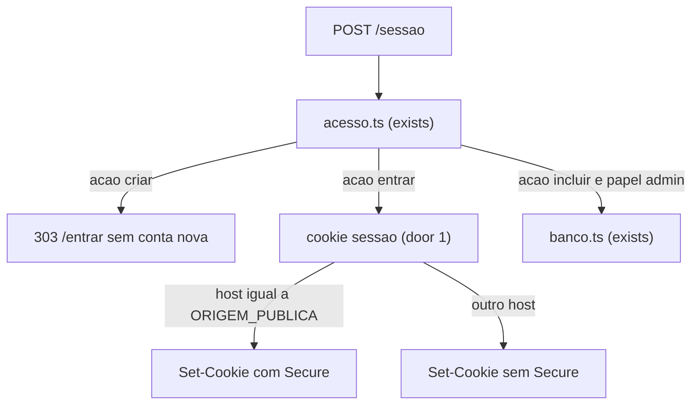

# URL pública

## Problem

A calculadora só abre em `http://127.0.0.1:4317`, neste computador. Quem está longe dela não abre o lote. O dono paga por isso: a conta da segunda pessoa, ou a dele, só existe na frente desta máquina. O login já separa as contas. O dono confirmou em 2026-10-08, em `.design/url-publica.md`, que o endereço aponta para este PC ligado, que conta nova é só do admin, e que o nome não é um domínio comprado. Quantas pessoas vão abrir não foi medido.

Quando isto chega, uma conta que já existe abre a calculadora num nome HTTPS fixo, longe de casa, com este PC ligado. Quem não tem conta vê Entrar e não cria conta.

## Flow

Isto reusa `acesso.ts` (exists) para decidir a rota e `banco.ts` (exists) para a inclusão do admin. Não nasce um segundo cadastro.

1. GET `/criar` entra em `acesso.ts` (exists) e responde 307 para `/entrar`. `banco.ts` (exists) não grava conta.
2. GET `/entrar` entra em `acesso.ts` (exists) e mostra `E-mail`, `Senha` e `Entrar`. O texto `Criar conta` não sai.
3. POST `/sessao` com `acao` `criar` para em `acesso.ts` (exists) antes de `banco.ts` (exists), responde 303 para `/entrar` e não grava cookie `sessao`.
4. POST `/sessao` com `acao` `entrar` grava o cookie em `senha.ts` (exists, door 1). `Secure` entra só quando o host do pedido, sem porta e em minúsculas, é igual a `ORIGEM_PUBLICA`.
5. POST `/sessao` com `acao` `incluir` e papel `admin` segue para `banco.ts` (exists), como já faz.
6. O serviço `app` do compose (exists, door 2) sobe com `npm run serve`, que constrói e escuta em `0.0.0.0:4317`. O Postgres (exists) continua sem porta no host.
7. out: `http://127.0.0.1:4317` e o host de `ORIGEM_PUBLICA` são o mesmo processo. O README (exists) e `docs/arquitetura.md` (exists) dizem os dois endereços.

## Impact

| Front | What changes |
| --- | --- |
| domain | existing term: `Criar conta` em `/entrar` e `/criar` era o cadastro de quem abre o app. Passa a não gravar conta. Quem ramifica hoje: `formulario-entrar.tsx`, `formulario-criar.tsx`, `html-conta.ts`, `acesso.ts`, `docs/arquitetura.md` e o critério 5 do plano de login |
| domain | existing term: cookie `sessao` era sempre sem `Secure` (AD-005). Passa a levar `Secure` só no host de `ORIGEM_PUBLICA` (AD-007). Quem ramifica hoje: `senha.ts` e o teste que exige a ausência de `Secure` |
| domain | existing term: quem escuta na 4317 era `npm run dev`. Passa a ser o app construído (AD-008). Quem ramifica hoje: `compose.yaml`, `package.json`, `docs/arquitetura.md` e `compose.test.ts` |
| stored data | nada a migrar. Contas, impressoras e projetos já gravados ficam. Fechar o cadastro não apaga linha |

## Relations

None - no stored-data shape change

## Surface

| Route | In | Out | Status |
| --- | --- | --- | --- |
| `GET /entrar` | cookie `sessao` opcional | título `Entrar` com `E-mail`, `Senha` e `Entrar`, sem o texto `Criar conta`; ou `Falta a senha da primeira conta.`; ou `Não deu para ler o banco.`; ou redireciona para `/` se o token vale | 200, 307 |
| `GET /criar` | cookie `sessao` opcional | redireciona para `/entrar` | 307 |
| `POST /sessao` | form `acao`, `email`, `senha`; cookie `sessao` opcional; header `Host` | `acao` `criar` redireciona para `/entrar` sem cookie e sem conta nova. `acao` `entrar` grava o cookie `sessao`, com `Secure` só se o host é `ORIGEM_PUBLICA`. `acao` `incluir` do admin continua gravando a conta | 303 |

## Landing

| One-way door | Literal shape | Alternative rejected |
| --- | --- | --- |
| 1. Cookie no nome público | `Set-Cookie` é `sessao=<token>; HttpOnly; SameSite=Lax; Path=/; Max-Age=604800`, mais `; Secure` somente quando o host do pedido, sem porta e em minúsculas, é igual à env `ORIGEM_PUBLICA`. Env vazia nunca acrescenta `Secure`. Apagar a sessão repete esse bit e usa `Max-Age=0` | `Secure` em toda resposta, porque `http://127.0.0.1:4317` descartaria o cookie; decidir `Secure` pelo esquema do soquete ou só por `X-Forwarded-Proto`, porque os dois endereços chegam como HTTP em 127.0.0.1 e um cliente pode enviar o header |
| 2. App construído | o comando do serviço `app` é `npm run serve`. O script é `next build && next start --hostname 0.0.0.0 --port 4317` | `npm run dev`, porque o overlay de erro do servidor de desenvolvimento iria para o nome público |

- Nada mais nesta mudança é difícil de reverter

## Criteria

### S1: Criar conta não grava (P1)

Quem abre Entrar não cria a própria conta. O admin continua incluindo em Usuários.

**Acceptance Criteria**

1. WHEN GET `/entrar` carries no cookie `sessao` and at least one conta exists THEN the system SHALL respond 200 with the title `Entrar` and SHALL show `E-mail`, `Senha` and `Entrar`.
2. WHILE GET `/entrar` is shown the system SHALL NOT include the text `Criar conta`.
3. WHEN GET `/criar` is requested THEN the system SHALL respond 307 with Location `/entrar`.
4. WHEN POST `/sessao` submits `acao` `criar`, email `outra@example.com` and password `senha-oito` THEN the system SHALL respond 303 with Location `/entrar`, SHALL NOT set cookie `sessao`, and SHALL persist zero contas for that email.
5. WHEN two POST `/sessao` of `acao` `criar`, email `race@example.com` and password `senha-oito` commit together THEN the system SHALL persist zero contas for that email.
6. IF POST `/sessao` submits `acao` `criar` with a valid admin `sessao`, email `admincria@example.com` and password `senha-oito` THEN the system SHALL respond 303 with Location `/entrar` and SHALL persist zero contas for that email.
7. WHEN POST `/sessao` submits `acao` `incluir` with a valid admin `sessao`, email `nova-publica@example.com` and password `senha-oito` THEN the system SHALL persist that email and SHALL respond 303 with Location `/usuarios`.

**Independent test:** abrir `/entrar` e não ver `Criar conta`. Enviar `acao` `criar` e contar zero contas novas. Incluir `nova-publica@example.com` em Usuários e ver a conta.

### S2: Cookie Secure só no nome público (P1)

Em casa o cookie continua sem `Secure`. No host configurado, ele leva `Secure`.

**Acceptance Criteria**

8. WHEN login succeeds with `ORIGEM_PUBLICA` `calculadora.exemplo.ts.net` and Host `127.0.0.1:4317` THEN cookie `sessao` SHALL be HttpOnly, SameSite `Lax`, Path `/`, Max-Age `604800`, and SHALL NOT include `Secure`.
9. WHEN login succeeds with `ORIGEM_PUBLICA` `calculadora.exemplo.ts.net` and Host `calculadora.exemplo.ts.net` THEN cookie `sessao` SHALL include `Secure` and SHALL keep HttpOnly, SameSite `Lax`, Path `/` and Max-Age `604800`.
10. WHEN login succeeds with `ORIGEM_PUBLICA` `calculadora.exemplo.ts.net` and Host `calculadora.exemplo.ts.net:443` THEN cookie `sessao` SHALL include `Secure`.
11. WHEN login succeeds with `ORIGEM_PUBLICA` `calculadora.exemplo.ts.net` and Host `Calculadora.Exemplo.ts.net` THEN cookie `sessao` SHALL include `Secure`.
12. IF `ORIGEM_PUBLICA` is missing or empty THEN a successful login SHALL NOT include `Secure` on cookie `sessao`.
13. WHEN logout is submitted with Host `calculadora.exemplo.ts.net` and `ORIGEM_PUBLICA` `calculadora.exemplo.ts.net` THEN the clearing `Set-Cookie` SHALL include `Secure` and Max-Age `0`.
14. WHEN logout is submitted with Host `127.0.0.1:4317` and `ORIGEM_PUBLICA` `calculadora.exemplo.ts.net` THEN the clearing `Set-Cookie` SHALL NOT include `Secure` and SHALL include Max-Age `0`.

**Independent test:** entrar com Host `127.0.0.1:4317` e ver o cookie sem `Secure`. Entrar com Host `calculadora.exemplo.ts.net` e ver `Secure`.

### S3: O processo da 4317 é o app construído (P2)

O compose deixa de subir o servidor de desenvolvimento. O Postgres continua sem porta no host.

**Acceptance Criteria**

15. The compose app command SHALL be `npm run serve`.
16. The `serve` script SHALL be `next build && next start --hostname 0.0.0.0 --port 4317`.
17. WHEN `docker compose up` is running THEN GET `http://127.0.0.1:4317/` SHALL respond 200.
18. The compose postgres service SHALL NOT publish a host port.
19. The README section `Como rodar` SHALL include `docker compose up`, `http://127.0.0.1:4317` and `https://calculadora.<tailnet>.ts.net`.
20. The system SHALL state in `docs/arquitetura.md` that the built server listens on `0.0.0.0:4317`.
21. The system SHALL state in `docs/arquitetura.md` that GET `/criar` responds 307 to `/entrar`.
22. The system SHALL NOT state in `docs/arquitetura.md` that the dev server listens on `0.0.0.0:4317`.

**Independent test:** `docker compose config` mostra `npm run serve` e o Postgres sem porta. `docker compose up` responde 200 em `http://127.0.0.1:4317/`.

## Out of scope

| Excluded | Why |
| --- | --- |
| `calculadora.local` | só resolve na rede desta casa |
| domínio comprado e porta 443 encaminhada no roteador | o dono não tem domínio e confirmou o Funnel |
| calculadora aberta com o PC desligado ou dormindo | o endereço aponta para esta máquina |
| e-mail para recuperar senha | ficou de fora no login |
| outros papéis além de `admin` e `comum` | ficou de fora no login |
| publicar o Postgres no host | a credencial é a de desenvolvimento; AD-002 |
| o comando `tailscale funnel` dentro deste repositório | o Funnel roda no host, na frente da porta 4317 |

## Assumptions

| Assumption | Chosen default | Rationale | Confirmed? |
| --- | --- | --- | --- |
| O nome da env é `ORIGEM_PUBLICA` e o valor é só o host, sem esquema | `ORIGEM_PUBLICA=calculadora.exemplo.ts.net` nos testes; vazia no compose de hoje | o desenho exige um host configurado; o nome da env é o default deste plano | n |
| A espera de 240s do teste de compose ainda cobre o `next build` | manter 240s | o app é pequeno e o teste já espera o compose subir | n |
| O Funnel roda no Windows, em `127.0.0.1:4317`, não dentro do container | `tailscale funnel 4317` no host, com o nó chamado `calculadora` | AD-008; o compose já publica 4317 no host | y |

**Open questions:**

| # | Kind | Question | Until answered |
| --- | --- | --- | --- |
| 1 | blocks go-live | Qual é o host real `calculadora.<tailnet>.ts.net` para gravar em `ORIGEM_PUBLICA`, e o Funnel já está ligado? | o nome público não abre para uma pessoa fora de casa. Os critérios 8 a 14 usam `calculadora.exemplo.ts.net` |

## Observable

| Surface | Decision | Landing |
| --- | --- | --- |
| screen `/entrar` | empty state | n/a - com conta, a página é o formulário; sem conta, o título `Falta a senha da primeira conta.` já existe |
| screen `/entrar` | loading | n/a - a página é renderizada no servidor, sem estado de espera |
| screen `/entrar` | error state | existing - `Não deu para ler o banco.` |
| screen `/entrar` | unauthorised | n/a - esta página é o destino de quem não tem `sessao` |
| screen `/entrar` | ordering | AC 1, AC 2 - `E-mail`, `Senha`, `Entrar`, sem `Criar conta` |
| screen `/entrar` | destructive action confirms | n/a - não há ação destrutiva nesta página |
| screen `/criar` | empty, loading, error, unauthorised, ordering, destructive | n/a - a rota só redireciona, AC 3 |
| screen `/usuarios` | incluir | AC 7 |
| screen `/usuarios` | empty, loading, error, ordering, destructive | existing - a lista e o `Apagar` não mudam neste plano |
| `POST /sessao` | error shape and codes | AC 4, AC 6 - `acao` `criar` responde 303 para `/entrar` e não grava conta |
| `POST /sessao` | who may call it | AC 6 - `criar` não grava nem com `sessao` de admin; AC 7 - `incluir` segue só para o admin |
| `POST /sessao` | versioning, rate limits | n/a - é o mesmo formulário do login, não uma API externa |
| document README `Como rodar` | structure and next step | AC 19 |
| document `docs/arquitetura.md` | structure | AC 20, AC 21, AC 22 |
| command `tailscale funnel` | flags, exit codes | n/a - o comando não é deste repositório; a pergunta 1 trava a ida ao ar |
| collection | grouping, order, duplicates | n/a - esta feature não organiza uma coleção |

## Sources

- `.design/url-publica.md` — nome `https://calculadora.<tailnet>.ts.net`, cadastro fechado, cookie `Secure` só nesse nome, app construído
- `.specs/STATE.md` — AD-002, AD-005, AD-007, AD-008
