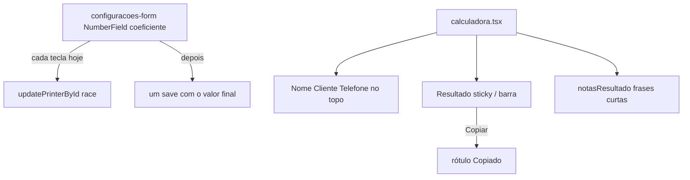

# UX calculadora

## Problem

Quem precifica na calculadora perde o total de vista enquanto preenche cores, tempo e mesas. O botão Copiar orçamento não confirma que a cópia saiu. Os avisos de cor vazia e de mesa vs peça estão corretos, mas longos demais para a hora do orçamento. Em Configurações, digitar o coeficiente de erro rápido demais grava só o primeiro dígito: cada tecla dispara `updatePrinterById`, e a resposta atrasada de um save antigo sobrescreve o valor novo.

O dono pediu, em 2026-10-28, estes cinco no mesmo trabalho: o bug do coeficiente, resultado sempre à vista, feedback ao copiar, avisos mais curtos sem mudar a regra, e nome do lote + cliente + telefone no topo do formulário.

Quando isto chega, o próximo orçamento mostra o total sem rolar, o coeficiente `20` grava inteiro mesmo digitado rápido, o Copiar confirma a cópia, os avisos cabem numa linha, e quem pediu a peça fica no começo da ficha.

## Flow

Reusa `NumberField`, `updatePrinterById` / `atualizarImpressoraNoBanco`, `textoOrcamento`, `podeCopiarOrcamento`, `notasResultado` e o card Resultado já sticky em `md:`. Não muda a fórmula em `custo.ts` nem o texto do cliente.

## Impact

| Front | What changes |
| --- | --- |
| domain | none - coeficiente, orçamento e cliente continuam como AD-009 e AD-010 |
| domain | existing term: o campo coeficiente já existe; o save passa a refletir o valor digitado por completo |
| stored data | none - nenhuma coluna nova; um coeficiente já gravado como `2` por engano só muda se o dono digitar de novo |

## Relations

None - nenhuma entidade nova.

## Surface

None - `/`, `/configuracoes` e as rotas existentes continuam. Nenhum contrato externo.

## Landing

| One-way door | Literal shape | Alternative rejected |
| --- | --- | --- |
| (none) | - | - |

- Nada nesta mudança é difícil de reverter. O sticky, a ordem dos campos e as frases curtas voltam num diff.

## Criteria

### S1: Coeficiente sem corrida (P1)

Digitar `20` no coeficiente e sair do campo grava `20`, não `2`.

**Acceptance Criteria**

1. WHEN the owner types `2` then `0` into Coeficiente de erro (%) on the active printer and the field blurs THEN the next read of that printer SHALL return coefficient `20`
2. WHEN two `updatePrinterById` calls for the same printer id are in flight with patches `{ coefficient: "2" }` then `{ coefficient: "20" }` THEN the next read SHALL return coefficient `20`
3. WHEN the owner types `20` with when=`blur` on the coeficiente NumberField THEN the system SHALL NOT persist an intermediate single-digit value as the final stored coefficient after blur settles
4. WHEN the coefficient field shows `20` after reload of `/configuracoes` THEN the calculadora total with closed cost lines SHALL equal the unscaled sum of those lines multiplied by `100 / (100 - 20)` as in AD-010

**Independent test:** em Configurações, digitar `20` rápido, sair do campo, recarregar e ler `20`; na calculadora o total sobe 25% sobre a soma das linhas.

### S2: Resultado sempre à vista (P1)

Os totais e o Copiar ficam à vista enquanto a pessoa preenche o formulário.

**Acceptance Criteria**

5. WHEN the viewport is at least the `md` breakpoint THEN the Resultado card SHALL remain sticky as it already does with `md:sticky md:top-28`
6. WHEN the viewport is below the `md` breakpoint and the lot total is a closed money amount THEN the system SHALL keep a visible control that shows the lot total and, when `podeCopiarOrcamento` is true, the Copiar orçamento action without requiring the user to scroll back to the Resultado card
7. WHEN the lot total is null THEN that compact control SHALL NOT offer Copiar orçamento

**Independent test:** no celular ou viewport estreita, com lote fechado, o total e o Copiar aparecem sem rolar até o fim da página.

### S3: Feedback ao Copiar orçamento (P1)

Depois de copiar, a pessoa vê que a cópia saiu.

**Acceptance Criteria**

8. WHEN the owner activates Copiar orçamento and the clipboard write succeeds THEN the control label SHALL become `Copiado` within one second
9. WHEN the label is `Copiado` THEN within three seconds the label SHALL return to `Copiar orçamento` (`ROTULO_COPIAR`)
10. WHEN the clipboard write fails THEN the selectable text fallback already in the calculator SHALL still appear and the control SHALL NOT claim `Copiado`

**Independent test:** copiar um orçamento fechado e ver o botão dizer `Copiado` antes de voltar ao rótulo original.

### S4: Avisos mais curtos (P2)

As regras dos avisos não mudam; só o texto fica mais curto.

**Acceptance Criteria**

11. WHEN `notasResultado` would previously push `Nenhuma cor de filamento. O material entra como R$ 0,00.` THEN it SHALL push a shorter Portuguese line that still states material is R$ 0,00 for lack of filament colors, and SHALL NOT change when that note appears
12. WHEN mode is `peca` without mesas and the note about peça única / sem cópias na mesa would appear THEN the system SHALL use a shorter Portuguese line with the same meaning
13. WHEN `FRASE_MESAS` is shown as the mesas description THEN the system SHALL use a shorter Portuguese line that still says each mesa is one plate (one time, one filament), the piece sums mesas, and copies multiply the product
14. WHEN any of those shortened strings change THEN `custo.ts` behavior and when the notes appear SHALL remain unchanged

**Independent test:** calculadora sem cores ainda avisa material zero; projeto de mesas ainda explica mesa numa frase curta.

### S5: Identidade do lote no topo (P1)

Nome, cliente e telefone ficam no começo do formulário do projeto.

**Acceptance Criteria**

15. WHEN the calculator renders the Projeto card THEN Nome, Cliente and Telefone SHALL appear before the printer select and before mode / copies / time / colors / mesas fields
16. WHEN those three fields move THEN their `data-testid` values `nome-projeto`, `cliente` and `telefone` SHALL remain and their save behavior SHALL remain unchanged

**Independent test:** abrir `/` e ver Nome, Cliente e Telefone no topo do card Projeto.

## Out of scope

| Excluded | Why |
| --- | --- |
| Envio WhatsApp / Evolution | `.design/envio.md` - feature seguinte |
| Cadastro de estoque de filamentos | backlog |
| Mudança na fórmula ou no texto do cliente do orçamento | AD-010 already sets both |
| Sticky / UX da lista de projetos | dono não pediu nesta rodada |
| Toast library nova se o rótulo Copiado basta | menor superfície |

## Assumptions

- Profile `light` (sem declaração em AGENTS.md).
- O Resultado já usa `md:sticky md:top-28`; S2 reforça viewport estreita, não remove o sticky desktop.
- Frases exatas dos avisos curtos o builder escolhe no tom do README, desde que os checks fixem as strings finais.

## Observable

- Coeficiente `20` sobrevive reload em `/configuracoes`.
- Botão de cópia oscila `Copiar orçamento` → `Copiado` → `Copiar orçamento`.
- Em viewport estreita o total do lote permanece acessível sem scroll até o card Resultado.

## Sources

- `.specs/STATE.md` - AD-009, AD-010
- Revisão manual 2026-10-28 em https://custo-chapa.vercel.app/ - coeficiente `20` às vezes gravava `2`
- Pedido do dono 2026-10-28 - cinco itens de UX na calculadora